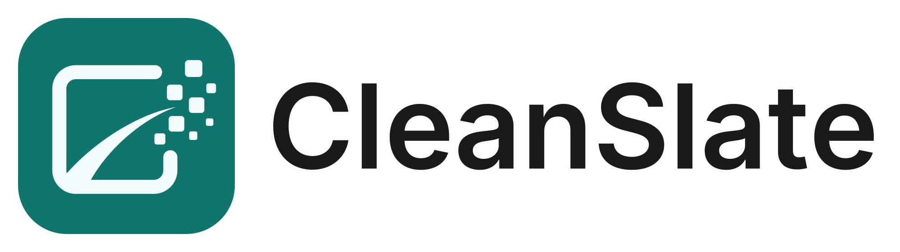
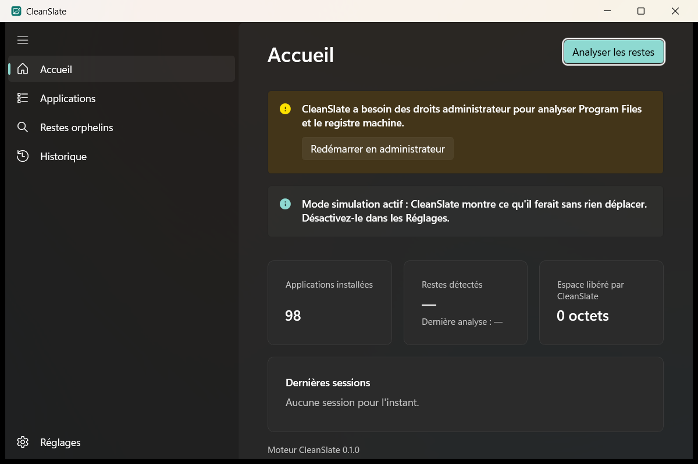
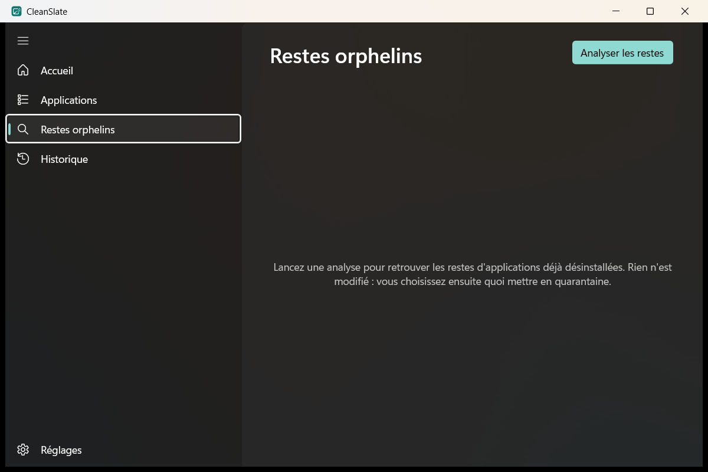
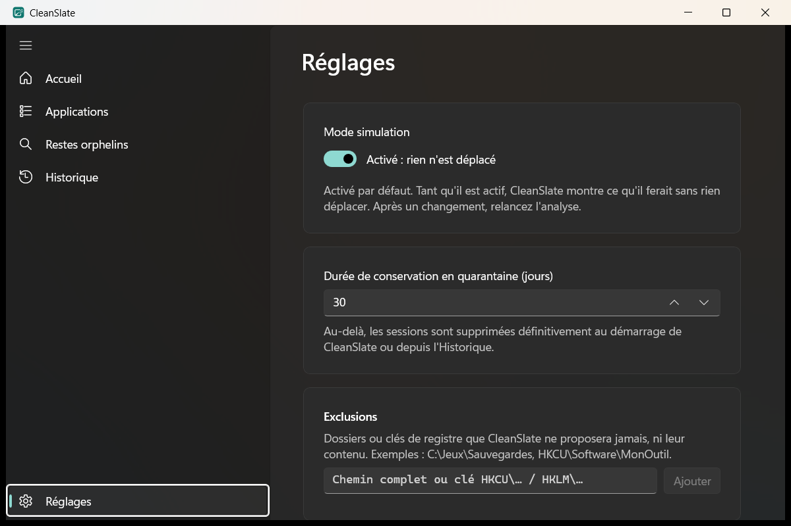

<picture>
  <source media="(prefers-color-scheme: dark)" srcset="assets/branding/cleanslate-logo-horizontal-dark.svg">
  
</picture>

# CleanSlate

Dernière mise à jour : 5 nov. 2026

**[⬇ Télécharger la dernière version (installeur Windows)](https://github.com/JOHNNY-nick/CleanSlate/releases)** · [Code signing policy](#code-signing-policy) · [Confidentialité](#confidentialité--privacy-policy)

Utilitaire Windows de gestion du stockage : une carte visuelle de ce qui occupe
chaque disque, un gestionnaire pour comprendre et libérer l'espace de toute la
machine, la désinstallation complète d'une application et la recherche des restes
d'applications déjà désinstallées.

## Pourquoi CleanSlate ?

En désinstallant des applications depuis les Paramètres de Windows, j'ai remarqué
que des fichiers restaient sur mon PC : dossiers dans AppData, clés de registre,
raccourcis… Je voulais pouvoir tout supprimer. J'ai donc imaginé une application
qui répond à deux besoins :

1. **Tout supprimer en une seule désinstallation** : l'application et tous les
   fichiers qu'elle laisse derrière elle.
2. **Retrouver les restes d'applications déjà désinstallées** et les supprimer,
   sans avoir besoin de connaître leur nom.
3. **Gérer le stockage sans fouiller dans les paramètres de Windows** : voir ce qui
   occupe chaque disque sur une carte, et libérer l'espace tout de suite, fichiers
   personnels compris.

Par sécurité, chaque suppression se confirme et propose deux modes : « Sûr »
(Corbeille ou quarantaine restaurable, par défaut) ou « Immédiat » (définitif).
Les zones sensibles de Windows ne sont jamais proposées automatiquement ; y agir
à la main demande le mode expert et la saisie de « CONFIRMER ».

> **État : v0.1.0 bêta, jalons J1 à J6 terminés.** [Installeur Windows disponible](https://github.com/JOHNNY-nick/CleanSlate/releases) ; les
> critères d'acceptation en conditions réelles se vérifient dans Windows Sandbox
> ([tests d'acceptation](docs/tests-acceptation.md)). Bilan : [revue finale](docs/journal/revue-finale.md).

- Moteur : Rust (`core/`), exposé en `cleanslate.dll` par une API C en JSON.
- Interface : C# 12 / .NET 8 / WinUI 3 non packagée (`app/`), patron MVVM.

## Fonctionnalités

- **Stockage** : carte visuelle de chaque disque, à parcourir dossier par dossier sans
  limite de profondeur, avec sous la carte la liste du dossier affiché (taille, date,
  type) ; on coche puis on supprime.
- **Gestionnaire** : diagnostic de chaque disque et des plus gros consommateurs, ce qui
  peut être libéré « sans risque » ou « à vérifier », catégories, gros fichiers, fichiers
  anciens, doublons, nettoyage par les outils de Windows, volumes ; rapport en PDF.
- **Applications** : inventaire des trois clés Uninstall (64 bits, 32 bits, utilisateur),
  recherche, tri, composants système masqués par défaut.
- **Désinstallation complète** en 5 clics : point de restauration, désinstalleur
  officiel (mode silencieux s'il existe), attente de tous ses processus, puis restes
  de l'application proposés au nettoyage.
- **Restes orphelins** : analyse de `Program Files`, `AppData`, `ProgramData` et du
  registre sans saisir de nom ; restes regroupés par application probable, avec un
  niveau de confiance ; seuls les éléments à confiance « Élevée » sont précochés.
- **Quarantaine** : en mode « Sûr », fichiers et clés sont déplacés avec un manifeste
  signé écrit avant chaque déplacement, restaurables à l'identique, en totalité ou
  élément par élément, pendant 30 jours (durée réglable).
- **Sécurité** : une liste à relire et une confirmation avant chaque suppression, zones
  sensibles de Windows jamais proposées automatiquement (mode expert et « CONFIRMER »
  pour y agir à la main), liens symboliques et jonctions jamais suivis, mot
  « QUARANTAINE » au-delà de 20 Go ([audit](docs/securite/audit.md)).
- **Historique**, exclusions personnelles, thèmes clair, sombre et contraste élevé,
  journaux locaux (7 jours). Aucune donnée envoyée sur Internet.

## Captures

| Accueil | Restes orphelins | Réglages |
| --- | --- | --- |
|  |  |  |

Captures prises en développement, sans droits administrateur (d'où l'avertissement
sur l'Accueil) et en mode simulation.

## Installer

[Télécharger l'installeur sur la page des versions](https://github.com/JOHNNY-nick/CleanSlate/releases) ou produire
`CleanSlate-0.1.0-setup.exe` (voir « Produire l'installeur »),
puis le lancer : il demande les droits administrateur et installe CleanSlate dans
`C:\Program Files\CleanSlate`. Le runtime .NET et le Windows App SDK sont inclus ;
rien d'autre à installer. Windows 10 2004 ou plus récent, x64.

L'installeur n'est pas encore signé : Windows SmartScreen affichera un avertissement.
Désinstaller CleanSlate garde `%LOCALAPPDATA%\CleanSlate` (quarantaine et historique),
pour que vous puissiez encore restaurer vos fichiers.

## Code signing policy

Free code signing provided by [SignPath.io](https://about.signpath.io/), certificate by
[SignPath Foundation](https://signpath.org/) (demande en cours : les versions publiées après
son acceptation seront signées ainsi).

- **Ce qui est signé** : uniquement les programmes construits à partir de ce dépôt par le
  workflow GitHub Actions [`release.yml`](.github/workflows/release.yml), sur les machines
  de GitHub. Les bibliothèques de Microsoft incluses (.NET, Windows App SDK) gardent leur
  propre signature.
- **Rôles** :
  - Committers and reviewers : [JOHNNY-nick](https://github.com/JOHNNY-nick)
  - Approvers : [JOHNNY-nick](https://github.com/JOHNNY-nick)
- Chaque signature est approuvée à la main, une fois par version. Les comptes de l'équipe
  (GitHub, SignPath) sont protégés par la double authentification.

### Confidentialité / Privacy policy

This program will not transfer any information to other networked systems unless
specifically requested by the user or the person installing or operating it.

CleanSlate ne transmet aucune information à un autre système en réseau, sauf demande
explicite de l'utilisateur ou de la personne qui l'installe ou l'utilise. Les journaux
restent sur le PC (`%LOCALAPPDATA%\CleanSlate\logs`) ; « Exporter les journaux » crée un
fichier sur le Bureau, que l'utilisateur choisit ou non de partager.

### Modifications du système

CleanSlate supprime des fichiers, des clés de registre et des applications, uniquement à la
demande de l'utilisateur : rien n'est coché d'avance dans les zones sensibles de Windows,
chaque suppression montre la liste et se confirme, le mode « Sûr » (Corbeille ou
quarantaine restaurable 30 jours) est proposé par défaut, et agir dans une zone sensible
demande le mode expert et la saisie de « CONFIRMER ». L'installeur s'accompagne d'une
désinstallation complète (Paramètres de Windows → Applications).

## Prérequis

| Outil | Version | Installation |
| --- | --- | --- |
| Windows | 10 22H2 ou 11, x64 | — |
| Rust | stable (1.99.1 au J1), cible `x86_64-pc-windows-msvc`, avec `rustfmt` et `clippy` | [rustup](https://rustup.rs), puis `rustup component add rustfmt clippy` |
| cargo-llvm-cov | dernière version | `rustup component add llvm-tools-preview` puis `cargo install cargo-llvm-cov` |
| Visual Studio 2022 (ou Build Tools 2022) | charges « Développement Desktop C++ », « Développement .NET Desktop » et « Développement d'applications WinUI » | Visual Studio Installer |
| .NET SDK | 8.0 | `winget install Microsoft.DotNet.SDK.8 --source winget` |
| PowerShell | 7.x | `winget install Microsoft.PowerShell --source winget` |
| Git | — | `winget install Git.Git --source winget` |

Le runtime Windows App SDK (1.8) est embarqué dans l'application : rien à installer à part.
Versions de référence des crates et paquets : [spécifications, § 2, § 3.1 et § 8.3](docs/specifications-techniques.md).

**Toutes les commandes ci-dessous se lancent depuis la racine du dépôt.**

## Compiler

```powershell
pwsh scripts/build.ps1 -Configuration Debug     # ou Release
```

Le script compile d'abord le moteur Rust (`cargo build`), ce qui régénère
`app/CleanSlate.Interop/NativeMethods.g.cs`, puis la solution .NET (`dotnet build`).
MSBuild copie alors `cleanslate.dll` à côté de l'application et des tests.
`-Configuration` s'applique aux deux : `Debug` utilise le profil cargo `dev`,
`Release` utilise `--release`.

## Produire l'installeur

Prérequis en plus : Inno Setup 6 (`winget install JRSoftware.InnoSetup --source winget --scope user`).

```powershell
pwsh scripts/package.ps1
```

Le script compile en Release, publie l'application en mode autonome dans
`artifacts/publish`, puis compile `installer/cleanslate.iss`. Résultat :
`artifacts/installer/CleanSlate-0.1.0-setup.exe` (environ 59 Mo).

## Tester

```powershell
cargo fmt --manifest-path core/Cargo.toml --all --check
cargo clippy --manifest-path core/Cargo.toml --workspace --all-targets -- -D warnings
cargo test --manifest-path core/Cargo.toml --workspace
cargo llvm-cov --manifest-path core/Cargo.toml --workspace   # couverture ≥ 80 % (ENF-12)
dotnet test app/CleanSlate.sln -p:Platform=x64
```

Les tests n'écrivent que dans des dossiers temporaires et sous
`HKCU\Software\CleanSlateTest\<uuid>`, supprimée à la fin de chaque test.
Les essais réels (quarantaine, désinstallation, scénario des 5 applications,
installeur) se font uniquement dans Windows Sandbox :
[docs/tests-acceptation.md](docs/tests-acceptation.md). Le scénario des
5 applications se lance seul et écrit son rapport dans `artifacts\sandbox\results` :

```powershell
pwsh scripts/sandbox/prepare.ps1 -Launch                      # scénario des 5 applications
pwsh scripts/sandbox/prepare.ps1 -Scenario Installer -Launch  # installeur
```

## Lancer

```powershell
app\CleanSlate.App\bin\x64\Debug\net8.0-windows10.0.19041.0\win-x64\CleanSlate.App.exe
```

L'exécutable s'appelle `CleanSlate.App.exe` (et non `CleanSlate.exe`) : une assembly
`CleanSlate.dll` écraserait la DLL native `cleanslate.dll`, car Windows ne distingue
pas la casse des noms de fichiers.

L'application demande les droits administrateur (manifeste `requireAdministrator`) ;
pour la déboguer, lancez Visual Studio en administrateur et ouvrez `app/CleanSlate.sln`.
Le mode simulation est actif par défaut.

Pour un essai rapide sans invite UAC, la variable d'environnement
`__COMPAT_LAYER=RunAsInvoker` lance l'application sans élévation :

```powershell
$env:__COMPAT_LAYER = 'RunAsInvoker'
app\CleanSlate.App\bin\x64\Debug\net8.0-windows10.0.19041.0\win-x64\CleanSlate.App.exe
Remove-Item Env:__COMPAT_LAYER
```

> ⚠️ **Réservé au développement.** Sans droits administrateur, l'application ne peut
> pas lire `HKLM` ni `Program Files` correctement : ses résultats seraient incomplets.
> Ne l'utilisez jamais ainsi pour une vraie analyse ou un vrai nettoyage.

CLI de debug (sans interface) :

```powershell
cargo run --manifest-path core/Cargo.toml -p cleanslate-cli -- version --json
cargo run --manifest-path core/Cargo.toml --release -p cleanslate-cli -- apps --json   # lecture seule
cargo run --manifest-path core/Cargo.toml --release -p cleanslate-cli -- scan --dry-run   # lecture seule
```

## Structure du dépôt

```text
core/                     workspace Cargo
  cleanslate-core/        logique métier : inventaire, scan, matcher, sécurité,
                          quarantaine, historique, désinstallation, journaux
  cleanslate-ffi/         cleanslate.dll : API C extern "C", JSON UTF-8
  cleanslate-cli/         binaire de debug
app/
  CleanSlate.App/         WinUI 3 : vues, services Windows (CleanSlate.App.exe)
  CleanSlate.Presentation/ ViewModels et interfaces de services, sans WinUI
  CleanSlate.Interop/     NativeMethods.g.cs (généré, versionné) + EngineClient
  CleanSlate.Tests/       xUnit v3 + NSubstitute
scripts/build.ps1         compilation complète
scripts/package.ps1       publication autonome et installeur
installer/cleanslate.iss  script Inno Setup
assets/branding/          logo et icônes
docs/                     cahier des charges, spécifications, design, maquettes,
                          décisions, journal des jalons, tests d'acceptation, captures
.github/workflows/        CI GitHub Actions (fmt, clippy, tests, couverture, build)
```

## Documentation

| Fichier | Contenu |
| --- | --- |
| [`docs/cahier-des-charges.md`](docs/cahier-des-charges.md) | Objectifs, périmètre, exigences EF/ENF, jalons J1 à J6, acceptation |
| [`docs/specifications-techniques.md`](docs/specifications-techniques.md) | Architecture Rust + C#/WinUI 3, API FFI, modèle, algorithme, sécurité, tests, compilation |
| [`docs/design.md`](docs/design.md) | Principes, jetons de couleur, parcours, textes d'interface, accessibilité |
| [`docs/maquettes/`](docs/maquettes/index.html) | 8 écrans en HTML : ouvrir `index.html` dans un navigateur |
| [`docs/prompt-claude-code.md`](docs/prompt-claude-code.md) | Mode d'emploi avec Claude Code et prompts des jalons J1 à J6 |
| [`docs/decisions.md`](docs/decisions.md) | Décisions prises en cours de projet (D01 à D44) |
| [`docs/journal/`](docs/journal/) | Plan et bilan de chaque jalon, revue finale |
| [`docs/tests-acceptation.md`](docs/tests-acceptation.md) | Procédures dans Windows Sandbox (automatiques avec `scripts/sandbox/`) |
| [`CLAUDE.md`](CLAUDE.md) | Consignes permanentes pour Claude Code (règles de sécurité, conventions) |

## Licence

[MIT](LICENSE)
